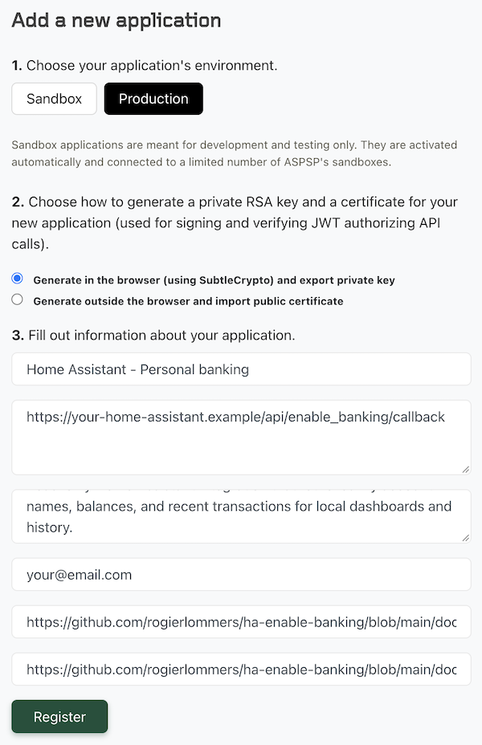

# Enable Banking for Home Assistant

[](https://github.com/rogierlommers/ha-enable-banking/actions/workflows/validate.yml)
[](https://github.com/hacs/integration)

A HACS custom integration that connects Home Assistant to bank accounts through the [Enable Banking API](https://enablebanking.com/docs/api/). It uses the open PSD2 API and can connect to 2,700+ banks across 30 European countries. It allows you to show account balances and get a list of recent transactions so you can create graphs, dashboards and alerts in home assistant. Example sensor usage:

- [Alert if balance is low](docs/alert_if_low_balance.md)
- [Receive daily account overview](docs/daily_account_overview.md)
- [apexcharts-card visualisation of balances](docs/apexcharts-card-overview.md)

## Requirements

- Home Assistant 2025.1 or newer with HACS installed.
- An EnableBaking application and its RSA private key.
- A publicly reachable HTTPS Home Assistant external URL, such as a Home Assistant Cloud URL.

## How to install

In HACS, add this repository as a custom **Integration** repository (https://github.com/rogierlommers/ha-enable-banking).
Then Install **Enable Banking** and restart Home Assistant.
Now create an account for EnableBanking. After that, in [Enable Banking / control panel](https://enablebanking.com/cp), register an application. Use the below screenshot to get an idea about what to fill in.



## The fields explained

| Enable Banking field | What to enter | Example |
| --- | --- | --- |
| **Application name** | A recognizable name. This may be shown by Enable Banking during bank consent. | `Home Assistant - Personal banking` |
| **Allowed redirect URLs (one per line)** | The exact public HTTPS Home Assistant callback URL. To check if you have the correct url. open the callback URL from outside your home network. An `Invalid or expired authorization request` response is expected. | `https://your-id.ui.nabu.casa/api/enable_banking/callback` |
| **Application description** | A short, accurate explanation of the read-only integration. Required for production applications. | `Read-only Home Assistant integration that retrieves my account names, balances, and optionally recent transactions for local dashboards and history.` |
| **Email for data protection matters** | Put your email address here. | `your@example.com` |
| **Privacy URL of the application** | A public HTTPS privacy notice. This repository provides a generic notice that all integration users may reference. | `https://github.com/rogierlommers/ha-enable-banking/blob/main/docs/privacy.md` |
| **Terms URL of the application** | A public HTTPS terms page. This repository provides generic terms that all integration users may reference. | `https://github.com/rogierlommers/ha-enable-banking/blob/main/docs/terms.md` |

When registration completes, the browser downloads a PEM file, usually named after the generated application ID:

```text
aaaaaaaa-bbbb-cccc-dddd-eeeeeeeeeeee.pem
```

Keep this file private and backed up securely. Open it in a text editor and paste its complete contents—including the `BEGIN` and `END` lines—into the **Private RSA key (PEM)** field in Home Assistant. Enable Banking cannot reconstruct the private key if it is lost. The application also has an ID. Both ID and the contents of the PEM file are needed when we start using the integration. So write them down or store them in your password manager.

Now add the Enable Banking integration in Home Assistant and enter:

| Home Assistant field | Value |
| --- | --- |
| **Application ID** | The Enable Banking application ID. |
| **Private RSA key (PEM)** | The complete private PEM key, including `begin` and `end`. |
| **Bank country** | The country where the bank account is held, such as `Netherlands`. |
| **Bank** | The bank you want to communicate with. |
| **Customer type** | `Personal` for a private account or `Business` for a business account. |
| **Requested consent duration** | The number of days to request access, for example `90`. |

## Entities, refresh options, and history

Each account is represented as a Home Assistant device with one **Balance** sensor. The sensor:

- uses the account's ISO 4217 currency as its unit;
- has the `monetary` device class and `total` state class;
- is retained by Home Assistant's recorder and long-term statistics.

### Integration options

After setup, open **Settings → Devices & services → Enable Banking → Configure** to change:

- **Refresh interval** — how often Home Assistant requests new data from Enable
  Banking. The allowed range is 15 to 1440 minutes (24 hours), and the default
  is 60 minutes.
- **Recent transactions per account** — how many transaction summaries to
  expose for each account. The allowed range is 0 to 20, and the default is 10.
  Set this to 0 to disable transaction API requests and transaction sensors.
- **Transaction lookback period** — how far back Enable Banking should search
  for transactions. Choose 7, 30, 90, or 365 days. The default is 90 days.

Saving options reloads the integration so the new polling interval and entities
take effect immediately.

The transaction count is a maximum, not a guarantee. The integration requests
transactions from the configured lookback date, follows at most five API pages,
sorts usable results by date, and exposes the newest configured number. A bank
may return fewer transactions because of consent, account type, API history
limits, or unavailable fields.

### Recent transaction sensors

When **Recent transactions per account** is greater than 0, each account gets a
**Recent transactions** sensor. Its state is the number of summaries currently
available. The `transactions` attribute contains a capped list with:

- booking, transaction, or value date;
- amount and currency;
- credit/debit direction;
- transaction status;
- counterparty name; and
- remittance text.

The integration deliberately omits account numbers, IBANs, provider transaction
IDs, postal addresses, and raw API responses. Counterparty and remittance text
are length-limited to bound state and recorder payloads.

Home Assistant does not provide per-dashboard confidentiality for entity
states. Authenticated Home Assistant users who are allowed to read entity states
may be able to retrieve transaction attributes even when the transaction card
is hidden from their dashboard. Enable transaction sensors only when all such
users are trusted, or apply instance-level access controls outside this
integration.

## Consent renewal

Bank consent has an expiry date. When it expires or is revoked, Home Assistant
marks the integration as requiring reauthentication. Open the integration and
complete the bank authorization again.

## Security

The RSA private key is a credential. Home Assistant stores it in the config
entry, which is not encrypted at rest. Protect Home Assistant's configuration
directory and backups. The key is never exposed as an entity attribute or in
integration diagnostics.

The callback accepts a one-time, high-entropy state value tied to the active
config flow. Authorization codes and private keys are not written to logs.

## Development

```bash
python3 -m venv .venv
.venv/bin/pip install -e '.[test]'
.venv/bin/pytest
```

## License

MIT
