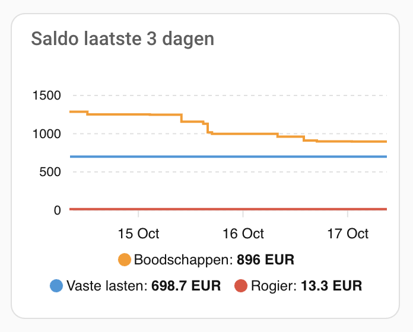

# Visualisation of your bank accounts

To display a visualisation of your bank accounts on your dashboard, use the snippet below.

```yaml
type: custom:apexcharts-card
header:
  show: true
  title: Saldo laatste 3 dagen
  show_states: false
  colorize_states: true
graph_span: 3d
cache: false
all_series_config:
  type: line
  curve: stepline
  stroke_width: 2
  extend_to: now
series:
  - entity: sensor.boodschappen_saldo
    name: Boodschappen
  - entity: sensor.vaste_lasten_saldo
    name: Vaste lasten
  - entity: sensor.rogier_saldo
    name: Rogier
apex_config:
  tooltip:
    enabled: true
    shared: true
  legend:
    show: true
    position: bottom
  markers:
    size: 0
  yaxis:
    decimalsInFloat: 0
grid_options:
  columns: 12
```

## The result


